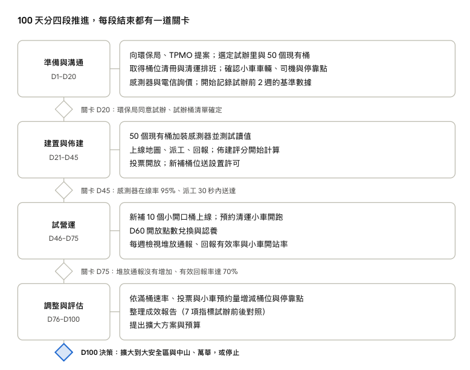

# BinSoon

BinSoon（台北丟垃圾變順）讓行人在 LINE 找到最近可用的垃圾桶，桶滿了自動派工給清潔員，趕不上垃圾車的人可以預約清運小車交家用垃圾。市政 debug 松・團隊「怎麼 Young 都 Soon」作品，Demo：[binsoon.app](https://binsoon.app/)。

## 市民怎麼說

**2,663 則留言的共識：桶被撤了之後，街道更髒，不是更乾淨。** 這些是市政 debug 松「找回消失的垃圾桶」題目下的台北市民去識別留言，涵蓋 12 個行政區。最常見的心情是生氣，大安與北投的生氣比例最高，都是 47%。

多數人主張用加蓋、小投入口、監視器和取締處理家用垃圾，而不是撤桶；其次是上班族追不到垃圾車，希望有定點收運。

### 痛點與 BinSoon 的解法

| 痛點 | 留言數 | 市民的話 | BinSoon 怎麼解 |
| ----- | ----- | ----- | ----- |
| 追不到垃圾車 | 約 230 則 | 「工作長時間，無法準時回家丟垃圾……也不是想偷丟人行道垃圾桶，卻搞得像賊一樣」（中正） | F9 預約清運小車：早晚兩班，下班也丟得到 |
| 桶被撤，找不到桶只好隨手丟 | 約 150 則 | 「手上垃圾走好幾百公尺都沒有地方丟，根本是逼我隨地棄置啊！」（信義） | F1 找桶地圖；F5 用數據找出缺桶的地方；F6 讓市民投票要桶 |
| 半夜偷丟、騎車來丟家用垃圾 | 約 130 則 | 「西昌街每天半夜都有人來丟包家戶垃圾，甚至騎車來丟棄，老鼠超多」（萬華） | F4 小開口桶擋整袋垃圾；F9 給家用垃圾合法的出口 |
| 僅存的桶太少，一下就爆滿 | 約 90 則 | 「有垃圾桶的地方常見到垃圾爆出來、散落在周遭」（大同） | F2 感測器滿 80% 自動派工，滿了才收 |
| 夜市、商圈、觀光客人潮 | 約 65 則 | 「台北橋下垃圾筒撤掉後，很多人把迪化街或夜市吃完的垃圾隨便丟在小巷弄中」（大同） | F5 評分把商圈與人流算進去 |
| 反映了也沒用、取締沒效果 | 約 60 則 | 「反應 1999 態度消極、環保局回說沒人力監督開罰」（萬華） | F3 拍照回報直接變工單，屬實給點；結案記錄垃圾組成，週報追蹤 |
| 掃街的清潔人員變少 | 約 40 則 | 「早晨原本都會看到的清掃人員，愈來愈難看到」（南港） | F2 依滿桶狀態排路線，省下定時巡邏的人力；F8 榮譽榜讓清潔隊被看見 |
| 為了省專用垃圾袋的錢 | 約 35 則 | 「為了省買垃圾袋錢，把垃圾塞在公共垃圾桶，再把公共垃圾桶移除」（文山） | 本版不處理，屬隨袋徵收政策 |
| 遛狗撿了狗便沒地方丟 | 約 13 則 | 「守法的遛狗的市民，乖乖把狗便撿起來要丟到哪？」（北投） | F1 地圖找最近的桶；F6 投票要桶 |

則數以關鍵字計算，一則留言可能同時講到多個原因。「追不到垃圾車」與「省垃圾袋錢」以全部 2,663 則計算，其餘以約 660 則談到亂丟、丟包的留言計算；引言為原留言節錄。

### 各區最主要的原因

| 行政區 | 留言數 | 最主要 | 其次 | 被點名的地點 |
| ----- | ----- | ----- | ----- | ----- |
| 大安 | 492 | 找不到垃圾桶 | 家戶垃圾丟包、取締不足 | 永康街、大安森林公園、忠孝敦化 |
| 中山 | 354 | 找不到垃圾桶 | 家戶垃圾丟包、取締不足 | 中山站、雙連站、松江南京站 |
| 萬華 | 241 | 觀光客與商圈人潮 | 家戶垃圾丟包、街友 | 西門町、華西街、青年公園 |
| 松山 | 233 | 垃圾桶爆滿 | 家戶垃圾丟包 | 饒河夜市、彩虹橋河濱、民生社區 |
| 信義 | 216 | 找不到垃圾桶 | 垃圾桶爆滿 | 市政府站、松壽路、信義商圈 |
| 中正 | 211 | 家戶垃圾丟包 | 找不到垃圾桶 | 台北車站、北門、中正紀念堂 |
| 士林 | 210 | 找不到垃圾桶 | 家戶垃圾丟包、夜市人潮 | 士林夜市、天母中山北路 |
| 大同 | 195 | 找不到垃圾桶 | 夜市觀光人潮 | 寧夏夜市、迪化街、台北橋下 |
| 內湖 | 155 | 家戶垃圾丟包 | 垃圾桶爆滿 | 內湖站、東湖安康公園、內科 |
| 北投 | 139 | 家戶垃圾丟包 | 找不到垃圾桶、取締不足 | 北投捷運站、北投文物館、石牌線型公園 |
| 文山 | 135 | 找不到垃圾桶 | 家戶垃圾丟包 | 萬隆街、景美夜市 |
| 南港 | 82 | 垃圾桶爆滿 | 找不到垃圾桶 | 昆陽站、南港軟體園區 |

### 為什麼先從大安區開始

大安區留言最多，佔全市 18.5%，市民常說撤桶是「因噎廢食」。永康公園的垃圾桶常爆滿，大安森林公園的新垃圾桶開口反而更大，老公寓住戶追不到垃圾車。這些正是 BinSoon 的地圖、小開口桶、滿桶派工和預約小車要解決的。

## 為什麼會這樣

臺北行人專用垃圾桶從近 3,000 組減到約 800 組。環保局只看「家戶垃圾違規棄置量」決定裁撤，撤除依據、行人需求和撤後成效也都沒有公開。

根本原因：

1. 家用垃圾整袋塞進行人桶  
2. 追不到垃圾車  
3. 桶太少又容易滿，滿了沒人知道  
4. 佈建只看單一數據，清運是定時巡邏，不是滿了才收  
5. 行人找不到桶

兩個解法互補：智慧垃圾桶處理「隨手垃圾」，預約清運小車處理「家用垃圾」。我們的定位是「先量、再決定」：每一次增設或撤除都要先有數據和理由，撤錯了能放回去。

## 誰在用、解決什麼

| 使用者 | 在系統裡做什麼 |
| ----- | ----- |
| 民眾 | 找到最近可用的桶、步行導航、回報桶況集點 |
| 市民參與 | 對系統算出的候選點投「支持／不支持」、認養家門口的桶（BinU） |
| 趕不上垃圾車的市民 | 預約早晚兩班清運小車，前一天收到路線通知，到站直接交家用垃圾 |
| 清潔員 | 桶滿 80% 自動收到 LINE 工單、依建議路線清運、結案回報垃圾組成；開小車照班表導航到站收運 |
| 環保局 | 每週收到佈建評估週報（建議新增／裁撤與理由），本版暫不做後台 |

## 功能（100 天範圍 F1–F9）

1. **F1 垃圾桶地圖**：每個桶是一隻 BinU，依容量顯示餓了（0–49%）、半飽（50–79%）、吃飽了（80% 以上）；吃飽時推薦下一個最近可用的桶  
2. **F2 滿桶派工與清運路線**：80% 推播給轄區清潔員；90% 以上或桶旁有堆放列為即刻處理（30 分鐘內）；依當日待清運的桶算路線  
3. **F3 回報與點數**：桶身 QR 掃碼，50 公尺內現場拍照，AI 先選好問題（桶旁有垃圾、滿了、很髒、損壞），清潔員到場確認屬實才給點；點數換超商咖啡等獎品  
4. **F4 小開口桶**：新補的桶開口做小、貼近捷運、公車、YouBike 站，擋住整袋家用垃圾  
5. **F5 佈建評分**：大安區切成 250m × 250m 網格，每週算需求分數與風險分數，產出評估週報  
6. **F6「這裡需要桶」投票**：只對系統算出的候選點投票；支持率超過 60% 且支持票超過該里設籍人口 0.1%，送環保局會勘  
7. **F7 認養 BinU**：免審核，每人最多 5 隻，同一隻不限認養人數；認養的桶回報點數 ×2，只在吃飽了時通知，可一鍵通報  
8. **F8 清潔隊榮譽榜**：依行政區顯示本月處理件數（結案且屬實）與民眾按讚數，排名只看件數  
9. **F9 預約清運小車**：給下班太晚、追不到垃圾車的人一個交家用垃圾的地方  
   * 每天兩班：早班 6:00–7:30、晚班 21:00–22:30  
   * 可預約未來 7 天，前一天 20:00 截止；預約只用來統計人數，沒預約的人當天也可以來  
   * 前一天 20:00 公布路線：滿 10 人的停靠點照常停，不到 10 人的併到最近的開站點，用 LINE 通知預約者改去哪  
   * 清潔員：小車班表 → 導航到停靠點 → 到站收運 → 下一站

## 佈建怎麼算

每個 250m 網格算一個需求分數（0–100），分數高、附近又沒桶的格子就是下一個該補桶的地方。

**D \= 0.35 行人流量 \+ 0.2 商圈 \+ 0.3 通報熱點 \+ 0.15 市民投票**

風險分數 H：家戶垃圾違規棄置量、桶旁堆放通報、離垃圾車停點距離，各自標準化後平均。

|  | 低風險（H \< 50） | 高風險（H ≥ 50） |
| ----- | ----- | ----- |
| 高需求 | 設小開口桶 \+ 感測器 | 設智慧桶並加強巡查 |
| 低需求 | 維持現狀 | 考慮裁撤，導引到最近的桶 |

撤除規則：不因「被塞家戶垃圾」撤桶。要撤之前三項都要通過：

容量連續 4 週在 30% 以下、近 4 週以行人垃圾為主、步行 300m 內有其他桶。

撤除後追蹤周邊 4 週，周邊桶滿桶次數增加 50% 以上、累計 10 件以上堆放回報，

或投票達標，就重新評估設桶。權重與門檻都是預設值，需和環保局一起校正。

## 頁面結構

市民端與清潔員端各一個 H5（嵌入 LINE 官方帳號），各 4 個底部 Tab，共 22 頁；手機與 Web 共用同一份響應式頁面。

| Tab | 頁面 |
| ----- | ----- |
| 市民・地圖 | M1 首頁地圖、M2 垃圾桶詳情、M3 步行導航、M4 回報、M5 認養說明 |
| 市民・要桶投票 | V1 這裡需要桶、V2 投票紀錄 |
| 市民・預約小車 | C1 預約清運小車（含已有預約狀態）、C2 我的預約、C3 路線公布・併站通知 |
| 市民・我的 | U1 我的、U2 兌換獎品、U3 回報紀錄與審核結果、U4 我的 BinU |
| 市民・全域 | G1 登入／綁定（只在回報、投票、認養、兌換送出前出現） |
| 清潔員・工單 | S1 派工清單、S2 派工詳情與結案 |
| 清潔員・路線 | S3 清運路線 |
| 清潔員・小車班表 | D1 小車班表、D2 導航到停靠點、D3 到站收運 |
| 清潔員・榮譽榜 | S4 清潔隊榮譽榜 |
| LINE 訊息 | L1 工單推播、L2 小車路線通知 |

Demo 主線：

1. 民眾：M1 → M2 → M4 → U3、V1  
2. 預約小車：C1 → C2 → L2 → C3  
3. 清潔員：L1 → S1 → S2 → S4；D1 → D2 → D3

頁面上方可切換市民／清潔隊。

## 100 天落地計畫

先用現有桶加裝感測器起步，不等新桶設置許可；小車和新補桶在 D46 後才上路。D1 \= 黑客松結束後第一個週一。

任一關卡沒過就停下來調整，不硬衝下一段；D45 前只動現有桶，就算小車和新桶延後，滿了才收仍能先驗證。

**100 天成效指標**（目標值為假設，需和環保局確認基準）

1. 滿溢未處理時間降 10%  
2. 每週清運趟數降 10%  
3. 桶旁家用垃圾堆放通報不增加（目標降 10%）  
4. 高需求但沒有桶的網格減少 10%  
5. 民眾有效回報率 70% 以上  
6. 感測器在線率 95% 以上  
7. 小車開站率與每班實際收運人數  
   

### 局處：需要合作的單位

主責是環保局，入口走資訊局的臺北智慧城市專案辦公室（TPMO），D1 兩邊同時開始談。過去行人清潔箱的設置與遷移，要由區清潔隊會同新建工程處、警察分局、交通局和里辦公處現勘，這次的會勘對象也照這個名單找。

| 優先 | 單位 | 為什麼要找 | 要談什麼 | 開始 |
| ----- | ----- | ----- | ----- | ----- |
| 1 | 環保局（環境清潔相關科室、大安區清潔隊、衛生稽查大隊） | 主責機關，桶、清運和小車都歸它管 | 試辦同意、桶位清冊與違規棄置資料、清運改滿了才收、小車車輛與司機、評估週報格式、榮譽榜顯示姓名與專案加給 | D1 |
| 1 | 資訊局／TPMO | PoC 媒合與跨局處協調 | PoC 提案、台北通介接、data.taipei 資料、資安與個資規範 | D1 |
| 2 | 大安區公所、試辦里辦公處 | 在地溝通，里長最了解誰在塞垃圾 | 試辦里選擇、小車停靠點、投票的里長確認流程、里民說明會 | D10 |
| 2 | 民政局 | 投票門檻要用各里設籍人口 | 各里設籍人口資料的取得與更新頻率 | D10 |
| 2 | 工務局新建工程處、公園路燈工程管理處 | 人行道和公園的設置空間 | 新補桶的設置許可與會勘 | D15 |
| 2 | 交通局（公共運輸處）、YouBike 營運單位 | 公車站、YouBike 站是新桶主要位置；小車要臨停 | 站旁設桶、小車臨停點與交通安全 | D15 |
| 2 | 臺北捷運公司 | 捷運出口人流最大 | 出口旁設桶、站點進出量資料 | D15 |
| 2 | 警察局（大安分局） | 新補桶位與小車停靠點的會勘單位 | 設置位置會勘、小車臨停安全 | D20 |
| — | 電信業者、感測器廠商 | NB-IoT 和設備 | PoC 提供設備或優惠價 | D1 |
| — | 超商、大獎贊助商 | 點數兌換 | 兌換券與大獎合作、經費 | D30 |

### 資料：需要開放或串接的資料

佈建評分、派工和小車路線都靠資料算，Demo 已匯入公開的桶位點位，其餘要在 D1–D20 向各單位申請，D21 起陸續串接。座標統一由 TWD97 轉成 WGS84。

| 資料 | 來源 | 用在哪 | 狀態 |
| ----- | ----- | ----- | ----- |
| 行人專用清潔箱點位 | 環保局（公開資料） | F1 地圖、F5 現有桶位 | 已匯入 Demo（681 個公有桶、130 個熱點） |
| 桶位清冊與清運排班 | 環保局 | F2 派工基準、試辦前後對照 | 需申請 |
| 家戶垃圾違規棄置與裁罰紀錄 | 環保局、衛生稽查大隊 | F5 風險分數 H | 需申請 |
| 垃圾車清運點位與時間 | 環保局 | F5 風險分數 H、F9 小車停靠點避開垃圾車路線 | 需確認開放格式 |
| 捷運各站進出量 | 臺北捷運公司 | F5 行人流量 P | 需確認是否到出口層級 |
| 公車站牌、YouBike 站點 | 交通局、YouBike 營運單位 | F4 新桶位置、F5 行人流量 P | 公開資料，待串接 |
| 夜市、市場、商圈位置 | 市場處、商業處 | F5 商圈 C | 公開資料，待串接 |
| 1999 與陳情紀錄（垃圾桶、亂丟相關） | 環保局、研考會 | F5 通報熱點 R | 需申請，去識別後提供 |
| 各里設籍人口 | 民政局 | F6 投票門檻（里人口 0.1%） | 公開資料，待串接 |
| 台北通登入 | 資訊局 | G1 一人一帳號 | 需申請介接；備案為手機簡訊驗證 |
| 感測器即時滿度 | 本案建置（NB-IoT） | F1 狀態、F2 派工、F5 修正 | D21–D45 安裝 |

本案產出的資料：每週評估週報（每桶分數、建議新增與裁撤、垃圾組成比例）只給環保局，不對外公開；試辦結束可討論把桶位與滿度統計回饋到開放資料平台。

### 經費：開發與營運成本

大安區 60 桶、2 條小車路線、100 天試辦：自行開發約 **90 萬元**，委外開發約 **170–240 萬元**。差別只在開發人力；營運 100 天約 32.4 萬元，兩種做法相同。除標註來源外皆為估算，需向廠商與環保局詢價。

| 類型 | 自建（萬元） | 委外（萬元） | 包含 |
| ----- | ----- | ----- | ----- |
| 開發（一次性） | 58 | 138–208 | 硬體 58（感測器 30、小開口桶 25、標示 3）＋ 開發人力 0（自建）／80–150（委外） |
| 營運（100 天） | 32.4 | 32.4 | 雲端 2、NB-IoT 2.4、LINE 與簡訊 2、小車 16、兌換券 5、宣導 5 |
| 合計 | 約 90 | 約 170–240 |  |

| 類別 | 項目 | 單價（元） | 數量 | 小計（萬元） |
| ----- | ----- | ----- | ----- | ----- |
| 開發・硬體 | 現有桶加裝感測器（含支架、安裝） | 5,000 | 50 桶 | 25 |
| 開發・硬體 | 新補小開口桶（本體，參考桃園訂製價） | 25,000 | 10 組 | 25 |
| 開發・硬體 | 新桶感測器 | 5,000 | 10 個 | 5 |
| 開發・硬體 | 桶身標示與 QR 貼紙 | 500 | 60 個 | 3 |
| 開發・軟體 | 開發人力 | — | — | 0（自建）／80–150（委外） |
| 營運 | 雲端主機與資料庫 | 5,000／月 | 4 個月 | 2 |
| 營運 | NB-IoT 通訊費 | 100／月 | 60 張 × 4 個月 | 2.4 |
| 營運 | LINE 推播與簡訊驗證 | — | 4 個月 | 2 |
| 營運 | 預約清運小車（需確認是否含司機人力） | 1,000／趟 | 2 路線 × 2 時段 × 40 天 | 16 |
| 營運 | 回報點數兌換券（總量上限，額滿即停） | — | — | 5 |
| 營運 | 宣導（里民說明會、海報） | — | — | 5 |
| 營運 | 清潔隊清運人力 | — | — | 0（沿用既有人力，改為滿了才收） |

各階段花在哪：

1. D1–D20：詢價、採購感測器（25 萬），開發人力開始投入

2. D21–D45：50 桶安裝感測器；雲端、NB-IoT、LINE 開始計費

3. D46–D75：新補 10 桶與感測器（30 萬）、小車開跑（16 萬）、D60 起兌換券（上限 5 萬）；宣導集中在 D46 與 D60 兩波

4. D76–D100：只剩營運費用，同時整理擴大方案的預算

經費來源：

1. TPMO PoC：市府提供場域，業者帶方案進場驗證

2. 環保局既有清潔預算：清運趟數下降省下的油料與工時，回補感測器、通訊費與小車費用

3. 企業贊助：兌換券找超商、大獎找航空或 3C 品牌、感測器找電信業者以 PoC 提供

4. 認養店家：贊助桶身與維護費用

機票、iPhone 等大獎不在預算內，需找贊助。

### 推廣計劃：讓市民用得到

市民不用下載 App：掃桶身 QR 或點 LINE 選單就能用，所以推廣重點是讓人在「手上有垃圾」和「趕不上垃圾車」的那一刻看到入口。分兩波：D46 新桶與小車上線，D60 兌換與認養開放。

| 對象 | 在哪裡看到 | 做法 | 時間 |
| ----- | ----- | ----- | ----- |
| 路過的行人 | 試辦的 60 個桶 | 桶身貼「只收隨手垃圾」與 QR Code，掃碼直接看桶況、回報 | D21 起，隨感測器安裝 |
| 通勤族 | 捷運出口、公車站、YouBike 站 | 新桶旁海報：「找桶、回報、集點換咖啡」 | D46 |
| 試辦里居民 | 里民說明會、里辦 LINE 群、公布欄 | 里長說明投票規則、小車停靠點與時段 | D20–D45 說明會，D46 前公告 |
| 追不到垃圾車的上班族、租屋族 | 垃圾車停點、老公寓樓下、社區公告 | 張貼「趕不上垃圾車？預約小車」，掃碼進預約頁 | D40 起，小車上線前 |
| 店家 | 永康街、師大等商圈店家 | 邀請認養門口的 BinU，店門口貼認養標示，回報點數 ×2 | D60 |
| 所有市民 | 環保局與市府 LINE 官方帳號、社群 | 圖文選單加「找垃圾桶」「預約小車」；發新聞稿與 Demo 影片 | D46、D60 兩波 |
| 清潔隊 | 大安區清潔隊勤前教育 | 說明 LINE 派工、小車班表與榮譽榜，先讓隊員願意用 | D30–D45 |

推廣成效每週和週報一起看，對照埋點：

1. LINE 官方帳號好友數、圖文選單

2. 桶身 QR 掃碼次數

3. 有效回報數與回報有效率

4. 小車預約數與開站率

5. 認養人數、投票數

## 推廣目標值待和環保局一起訂；D75 中期檢討時，掃碼或預約明顯偏低的里，再加開說明會或調整海報位置。

## 主要風險

| 風險 | 應對 |
| ----- | ----- |
| 補桶後家用垃圾反而變多 | 新桶一律小開口；容量暴增列為稽查點；家用垃圾導到預約小車；每週追蹤堆放通報 |
| 小車預約量太低、停靠點開不成 | 不到 10 人自動併站；宣導集中在試辦里；依預約量調整停靠點與班次 |
| 公部門流程超過 100 天 | 先用現有桶加裝感測器，不等新桶許可與小車 |
| 感測器誤判 | 回報與感測器交叉比對；24 小時不變或忽高忽低標為讀值異常，不列入評分 |
| 回報被刷點數 | 每人每週上限、兌換券總量上限、清潔員確認屬實才入帳 |
| 榮譽榜讓人草率結案 | 結案以感測器歸零與完成照片為準；按讚不列入排名 |

## 團隊

| 角色 | 成員 |
| ----- | ----- |
| 產品（概念發想、剪輯影片局處溝通、PoC 提案、成本與成效報告） | Janet |
| 設計（市民端、清潔員端介面與視覺風格） | Charles、Anting |
| 開發（前端功能實現、感測器串接、資料庫、演算法） | Wen、PinYuan  |

# 資料來源、Demo 範圍與工具使用揭露

BinSoon 本次展示重點為解決方案與可操作介面，採用真實公開地理資料，搭配模擬桶況及作業流程。Demo 不代表已與臺北市政府、清潔隊、感測器設備或獎品兌換業者正式介接。以下以目前實作為準；前文的 100 天落地計畫與產品規劃，不等同於 Demo 已完成能力。

## 一、實際串接的外部服務

| 項目 | 實際使用方式 | 展示限制 |
| ----- | ----- | ----- |
| 地圖底圖 | 使用 OpenFreeMap 地圖圖磚服務，必要時使用 OpenStreetMap 圖磚。 | 真實道路與地理背景；桶況為另外產生的模擬資料。 |
| 道路路線 API | 使用 Valhalla 計算市民步行、清潔員清運及小車導航的道路路線、距離與預估時間。 | 起點、站點或移動進度採展示設定，未取得真實 GPS，也不包含即時路況或完整車隊排程最佳化。 |
| LINE 分享 | 使用 LINE 官方分享連結，由使用者自行完成分享。 | 分享連結不等於 LINE 登入、LIFF 或工單／通知推播串接。 |

## 二、使用真實公開資料，但不是即時 API

| 資料 | 使用內容 | 注意事項 |
| ----- | ----- | ----- |
| 臺北市既有清潔箱資料 | CSV 快照共 681 筆公布桶位，其中大安區 47 筆，包含行政區、地址與經緯度。 | 保留來源追溯資訊；不保證現場仍有設置，也不提供即時滿度。 |
| 景點／商圈清潔箱統計 | 共 130 筆場所代表點，其中大安區 18 筆。 | 代表場所位置及周邊桶數，不能視為 130 個獨立垃圾桶。 |
| 臺北市行政區界 | 使用公開區界圖資，協助核對點位行政區。 | 採下載快照，不是即時更新服務。 |

預設 Demo 直接讀取上述資料產生的靜態快照，不會即時向政府 API 查詢桶位。681 筆桶位與 130 筆場所代表點，合計為 811 筆位置紀錄，不能稱為 811 個垃圾桶。

## 三、模擬資料與互動流程

| 功能 | 模擬範圍 |
| ----- | ----- |
| 桶況與感測器 | 滿度百分比、餓了／半飽／吃飽、清運歸零等為程式產生；未接實體 IoT。每桶的一般垃圾與回收雙槽也是展示假設，原始 CSV 無種類證據。 |
| 市民／清潔員登入 | 使用虛構展示身分，未串接台北通、LINE Login 或簡訊驗證。 |
| 拍照、定位與 AI 判讀 | 使用生成圖片、模擬座標與預設判讀結果，未啟用真實相機、GPS 或影像辨識 API。 |
| 回報、派工與結案 | 使用模擬案件及本機操作，展示查證、處理、清運及結案流程，不向真實清潔隊派工。 |
| 點數與獎品 | 點數、庫存、兌換紀錄及展示券為模擬資料，無法兌換真實商品。 |
| 建議設置點與投票 | 使用 10 個模型建議點快照及示範票數，操作可在本機累加；不代表真實民意、官方核准或已設置，建議點仍須現勘。 |
| 認養 BinU | 認養、私人命名及獎勵效果為本機展示，不代表取得官方認養資格。 |
| 榮譽榜與成果統計 | 清潔員姓名、處理件數、按讚與成果來自展示資料及本機操作，不是政府績效資料。 |
| 預約清運小車 | 班次、停靠點、基礎人數、併站及到站收運為本機模擬；道路導航使用真實路線 API，但沒有實際派車或通知預約者。 |

展示操作主要保存在目前瀏覽器，並非多人同步的正式營運資料。

## 四、已有後端 API，與預設 Demo 分開

專案另有自建 BinSoon 後端 API，提供桶位查詢、身分驗證、回報、工單、投票、認養及點數等功能，保留供後端模式串接使用。預設市民及清潔員展示主要使用本機資料；即使切換後端模式，模擬感測讀值、照片與座標也不會因此變成真實實測資料。

## 五、規劃功能與個資原則

250m 網格需求／風險評分、每週自動評估報告、實體感測器、LINE 工單與小車通知推播，屬後續驗證或介接規劃，不應列為目前已完成的真實服務。

Demo 使用虛構帳號、人物與生成照片，不使用真實市民或清潔員個資；展示時請勿輸入真實姓名、電話、住址、個人定位或可辨識人物的照片。

## 六、使用的開源套件與技術

| 類別 | 套件／技術 | 用途 |
| ----- | ----- | ----- |
| 前端介面 | React、React DOM、TypeScript | 建置市民端與清潔員端的響應式操作介面。 |
| 開發與建置 | Vite | 本機開發、前端打包與預覽。 |
| 地圖呈現 | Leaflet、MapLibre GL JS、MapLibre GL Leaflet | 顯示地圖、桶位、站點與導航路線。 |
| 圖示 | Lucide | 一般垃圾與資源回收等介面圖示。 |
| 資料處理 | csv-parse | 解析公開資料 CSV，產生展示用點位快照。 |
| 後端 API | FastAPI、Uvicorn | 提供自建 API 與後端服務。 |
| 資料驗證 | Pydantic、pydantic-settings | 驗證請求資料與讀取環境設定。 |
| 資料庫與空間查詢 | PostgreSQL、PostGIS | 儲存桶位、作業紀錄，進行空間距離查詢。 |
| 資料存取與遷移 | SQLAlchemy、GeoAlchemy2、psycopg、Alembic | 資料庫操作、空間欄位處理與版本遷移。 |
| 圖片處理 | Pillow | 後端圖片讀取、驗證與處理。 |
| 測試與程式格式 | Playwright、pytest、HTTPX、Prettier | 瀏覽器流程測試、後端測試與程式格式統一。 |

地圖底圖另使用 OpenFreeMap／OpenStreetMap，道路路線使用 Valhalla 公開服務。這些是外部地圖與路線服務，與專案內安裝的套件分開列示。各套件及圖資依其授權條款使用，保留相關署名。

## 七、AI 工具使用揭露

| AI 工具 | 使用方式 |
| ----- | ----- |
| Claude | 協助產出產品需求文件（PRD）、Web／手機介面流程及使用者流程，供團隊討論與實作參考。 |
| OpenAI Codex | 作為程式開發協作工具，協助程式撰寫與修改、問題排查、測試及文件整理；需求與採用內容由團隊確認。 |

上述 AI 工具用於開發與內容製作階段，不代表 Demo 執行時有呼叫 AI API。目前介面中的「AI 判讀照片」使用本機預設結果與互動模擬，沒有串接真實影像辨識模型，也未將回報照片送至外部 AI 服務。
