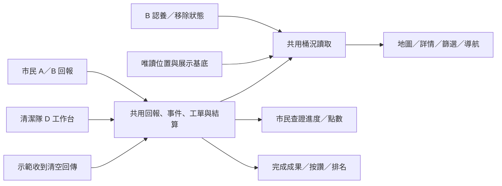

# D flow：清潔隊工作台與 A／B 整合規格

> 2026-10-19 API 串接 #6–#8：正式首頁已接後端地圖／身份／照片回報與隊員查證；完工及其他後續流程仍未開放。下文為原本機展示規格及驗證歷史，舊展示只保留於開發測試入口，舊帳本不匯入後端。以 [前端 README](../frontend/README.md) 與 [串接驗證](FRONTEND_API_INTEGRATION_VALIDATION.md) 說明的目前範圍為準。

2026-10-19，使用者四輪確認完成。**產品決策已確認，前端本機展示與 A／B 接合已實作。** 決策歷程及原文核對見 [討論紀錄](D_FLOW_OPEN_QUESTIONS.md)。本文件為 D 實作及 A／B 接合的依據；實際驗證及未驗證範圍見 [D flow 驗證紀錄](D_FLOW_VALIDATION.md)。

## 來源與優先序

依 [PRD 1018](https://claude.ai/artifact/2K68x1RzGGiqZCFeXEK2i2#42996e66-512d.mffekfma0dy.24403) 的 F1／F2／F3／F8，對照 [Web flow P18–P22](https://claude.ai/artifact/KB6pHmz23RY1EmUNYCtfk4#page-d63f1065a6ff)、[手機 Web P17–P22](https://claude.ai/artifact/KB6pHmz23RY1EmUNYCtfk4#page-ed25c7b30423) 與 [User Flow Story 2](https://claude.ai/artifact/KB6pHmz23RY1EmUNYCtfk4#page-227cd962ddd2)。已透過登入瀏覽器核對；未驗證匿名權限。

以本次使用者確認決策為準：沿用 PRD 的查證發點、感測清空與完成照、案件數排名；補足非滿桶問題、逐筆查證、事件週期與舊帳本相容。通知、身份、照片及感測回傳採明示本機展示；使用者於同日追加機車／汽車道路指引，P20改用公開路線服務計算，起點與站點順序仍為展示，不照搬100天試辦的真實服務要求。

## 交付與資料界線

同一個 React＋TypeScript＋Vite frontend、同一次部署，新增 `#staff/...` 工作台及專屬版型。市民原有深連結保留；工作台不套市民點數／會員導覽。展示切換區可選獨立的「大安區示範隊員」，直接開啟工作台連結也先確認該示範身份；這是展示選擇，不是正式認證。

隊員只操作大安區工單，與市民登入分開，切換角色或登出不清除資料。本版不加入多人搶單、隊長派單或隊長審批；認養核准、設桶評估與命名審查沿用 B 的展示控制。A 的其他行政區資料仍保留，不把區外回報分派給大安區隊員；區外回報需明示超出本次隊員展示範圍。

本版支援同一瀏覽器、同源分頁的 A／B／D 狀態更新與重整保存，不支援跨裝置同步。無真實登入、LINE、相機、GPS、路網、感測器接收、IoT通訊或薪資發放。正式產品的目標是感測器量測後聯網回傳後台，再由市民與隊員介面讀取；本次用明示的「示範收到清空回傳」操作呈現此流程，不建立連續填滿模擬或假後台服務。

工單只能關聯既有公布桶 UUID；`TP-xxx` 仍是展示碼，不當作官方設備編號。681筆公布桶位置、130筆場所代表點與所有追溯欄位維持完整。場所、候選點、B提案、示範設置成果及缺口分析不會轉成待清運的既有桶，不修改原始快照或後端三張資料表。

## 頁面與操作

以下 hash 為整合規劃；實作時保留等價深連結與操作能力即可。

| 頁面 | 規劃入口 | 行為 |
| --- | --- | --- |
| 示範身份 | `#staff/login` | 選擇示範隊員、顯示責任區、返回原工作台連結；不要求市民登入才能工作。 |
| P17 工單通知 | `#staff/notifications` | 站內示範通知，點擊直達對應工單；不宣稱已傳LINE或真實推播。 |
| P18 派工清單 | `#staff/tasks` | 待處理、處理中、已完成；顯示來源、問題、優先度、建立時間、示範距離與目標時限。待修繕／待感測確認可在處理中辨識。 |
| P19 工單詳情 | `#staff/tasks/:id` | 接單、到場、逐筆查證、現況與完成證據、處理／無需處理／待修繕、感測回傳狀態與路線入口。 |
| P20 清運路線 | `#staff/route` | 同桶多張任務可同站呈現，保留各自完成條件；以示範順序安排待清運任務，可選機車／汽車產生道路路線與逐段指引，不算最佳路線。完成工單退出待辦，無下一站時顯示無待辦。待修繕仍可查，但不列一般清運下一站。 |
| P21 結案完成 | `#staff/tasks/:id/done` | 依實際完成結果呈現證據、查證／發點、隊員成果及下一站；不把無需處理描述成已清運。 |
| P22 隊員榮譽榜 | `#staff/honor` | 大安區個人示意排名、本月成果、歷史基數及本次增量、前三名加給示範說明。 |
| 市民榮譽榜入口 | 保留既有導覽位置 | 顯示清潔隊整體成果與感謝，不提供個人工單明細或隊員操作。 |

手機採卡片與容易操作的按鈕；桌面可用表格搭配地圖。兩端使用同一業務規則。沿用底圖署名、失敗提示、清單替代入口、鍵盤操作及頁面焦點管理。

## 回報、事件、工單與結算

| 概念 | 責任與不變條件 |
| --- | --- |
| 回報 | 一位市民的一筆說明／證據；保存所屬事件、提交時間、送出時認養資格、首報資格、查證結果及一次結算紀錄。 |
| 回報事件 | 同桶、同問題的一次未結案狀況；可含多筆回報，保存原首報與是否已關閉。 |
| 工單 | 每事件一張；同桶的滿桶與堆放是不同工單，不跨類型合併。保存執行隊員、工作狀態、各階段時間及完成證據。 |
| 感測觀測 | 桶內填滿程度及清空回傳，具有來源、量測與接收時間；與市民回報查證分開。 |
| 完成紀錄 | 可歸屬隊員的處理成果，連結工單及證據；用於計件、按讚與清運成果呈現。 |

同帳號在事件未關閉前重複操作，導向既有回報，不新增或重複得點。查證通過／不實都不等於事件關閉；只有工作完成或有證據的無需處理結果才關閉。待修繕與待感測確認維持未結案。事件關閉後問題重新發生，建立新事件並重新完成回報證據，不沿用舊照片或清空讀值。

其他市民的合併回報以清楚標示的虛構紀錄展示，不新增可登入帳號。感測器來源也可有示範事件／工單，但沒有市民回報時不產生市民點數。新回報的首報資格應依事件關聯決定，不能讓市民自行指定以繞過規則；舊案件資格與已發點數不重算。

隊員到場後逐筆選擇查證結果，不能預選屬實，不實必填原因。一筆不實不連帶否定其他回報；首報不實也不把獎勵遞補給後報。正式確認後結果鎖定，不能藉重複操作、重整或另一分頁重發點數／重記不實次數。

查證屬實時立即一次入帳：原首報一般+1、送出時已有效認養+2，後報0；後續才核准不補倍、結束認養不追扣既有案件。回報不實不給點，累積三次只暫停該市民回報及B快捷通報，不限制投票、提案或認養。虛構市民的查證不計入本機市民帳號的不實次數或點數。

市民 P7 同時呈現查證與執行進度：已入帳但待處理是合法狀態，不顯示已清乾淨。現有市民審核下拉移至 D，市民頁只讀；隊員工作不依賴市民的 `loggedIn`。本版不實作翻案、撤銷結案或追回已兌換點數。

## 工單生命週期與完成條件

正常流程為待接單→處理中→已到場→完成。先接單才能到場；先到場才能正式查證、提交工作結果。查證已終結不會把工單跳成完成。

| 情境 | 結果 |
| --- | --- |
| 滿桶 | 到場、完成該事件各回報查證、提交完成照，且有本次處理的新有效清空回傳，條件齊備自動完成；事件關閉，計件資格只評估一次。 |
| 已交完成照，尚無新清空回傳 | 顯示待感測確認及提醒；容量不憑空設為0%，工單不結案。 |
| 新清空回傳先到，尚無完成照／查證 | 立即更新桶內容量；工單仍待完成其他條件，不能先增加績效或開啟該次感謝。 |
| 桶旁堆放／很髒／其他 | 完成對應工作、逐筆查證與示範證據後，隊員明確完成；不以桶內清空替代現場證據。 |
| 損壞當場可修復 | 修復及證據確認後完成；解除維修限制，但不順帶修改容量。 |
| 損壞無法當場修復 | 填原因轉待修繕，事件不關閉；同一示範隊員後續確認修復。不假稱已通知其他單位。 |
| 現場已無需處理 | 填現況說明與示範現況照，完成回報查證後以無需處理關閉；不記作清運成果、不增加排名件數。 |
| 判定回報不實，但現場仍有工作 | 回報不給點，工單依現場狀況繼續處理。 |

重複點擊、重送同一清空回傳、讀值與照片到達順序不同，都不能重複完成、關閉事件、計件或發點。感測回傳只能關聯本次處理，舊事件清空或離線／無效資料不能滿足完成條件。

## 桶況與感測回傳

正式產品以桶內測距推算填滿程度；空桶校正、有效讀值、設備協定與真實接收端留待硬體整合。容量歸零不是測距為零。現階段只保存明示示範回傳及必要時間／來源，不能標成真實聯網資料。

收到有效清空回傳即更新桶內填滿程度，無須等待隊員按完成；桶旁堆放、外觀髒污、維修狀態各自保留。可更新桶內清空觀測時間，但「隊員已完成清運」與可按讚入口必須有可歸屬隊員的完成紀錄。

所有市民桶況入口讀同一份作業狀態：地圖標記、清單、桶況篩選、最近三桶、詳情與歷史展示、導航目的地與改導。不得出現詳情已空、地圖仍滿或導航仍以舊seed避開的矛盾。歷史圖表保留既有示意標示，新回傳不倒填成過去真實觀測。

讀值未知、無效或失聯不能視為0%；新回傳不被較舊觀測覆蓋。維修中／已撤除仍不屬市民可用桶，即使容量低也不能解除限制。B 的300m既有桶搜尋是位置存在性判斷，滿桶／未知仍算既有桶，不套市民導航的可用桶條件；保留B既有示範移除規則。

## 派工優先度、通知與路線

1. 即刻處理：桶旁堆放，或有效示意容量≥90%。
2. 優先：其他認養快捷通報、滿桶回報，或有效示意容量≥80%。
3. 一般：其他髒污、損壞與一般回報。
4. 稽查情境：僅有容量異常提示的示範任務。

符合多條件取最高級；同級按工單建立時間先後，再用固定ID維持順序。容量未知不臆造百分比。即刻處理顯示建單起30分鐘的示範目標與逾時提示，不承諾真實到場、不逾時自動結案或扣點。

P17是站內示意通知，直接連到正確工單。P20共用底層地圖，另有工作任務政策；清潔員需前往滿桶，不沿用市民避開滿桶的導航頁邏輯。起點與站點順序明示示範；依選擇的機車／汽車模式由 Valhalla 計算道路幾何、距離、預估時間及逐段指引。切換車種或站點變動即清除舊指引；失敗不以直線替代導航，沒有即時路況或最佳化排程。詳見 [清潔隊道路路線](CREW_ROUTING.md)。同桶多任務可同站呈現，下一站選未完成、適用一般清運的任務；無下一站顯示無待辦。底圖失敗仍可操作清單。

## 榮譽榜、按讚與獎勵

以台北時間曆月，依完成時間歸屬月份。確認有現場問題、完成對應工作且具完成證據才計件；每工單一次，不按市民回報筆數增加件數。感測器情境無市民回報也可在隊員確認現況及完成工作後計件；無需處理及待修繕不計。同桶兩問題各完成可計兩件。

同分並列名次，展示順序固定，按讚及速度不破同分。平均處理時間由接單至完成，缺時間顯示無資料。示意歷史基數與本次增量分開呈現，不虛構可查詢的歷史明細；跨月保留歷史，不把舊月基數當新月成果。

每月各區前三名專案加給是正式PRD的獎勵方向；本版只展示大安區排名、月底名單及加給說明，不設定或發放真實金額。個人排名留在隊員端，市民只看清潔隊整體成果。未新增實際姓名公開或薪資處理能力。

市民可對該桶最新一筆有證據的清運／清潔完成紀錄按讚，同帳號對該次完成最多一次；重整或跨分頁不能灌讚。讚歸屬執行隊員與其清潔隊，市民顯示隊整體；不換市民點數、不折現、不列排名。無完成紀錄不聲稱剛清乾淨。下次完成可再次感謝；舊版按桶保存的讚只保留歷史，不映射成新工單或隊員績效。

## 程式整合設計與順序

目前程式未分工作空間，A案件狀態同時承擔查證／結案，桶況由UUID seed推導。建議依下列順序實作；模組名稱是規劃，不代表檔案已新增。

| 順序 | 現有落點／規劃模組 | 變更責任 |
| --- | --- | --- |
| 1 | `data/reports.ts`、規劃 `data/workOrders.ts` | 分開回報查證、事件開閉、工單狀態與合法轉移；以純函式檢查首報、一次結算及完成條件。 |
| 2 | `data/demoStore.ts` | A與D共用同一權威狀態，保存回報、事件、工單、感測示範回傳、成果、讚及市民結算；不把A回報複製成D第二份。支援跨分頁寫入序列化與更新。 |
| 3 | `data/participation.ts` | B繼續擁有提案、認養與示範移除資料；新回報只在送出時讀取核准認養關係並固化資格，不把整個B帳本搬進D。 |
| 4 | `data/binDemo.ts`、規劃 `data/binOperations.ts` | seed只作展示基底；共用桶況讀取合併作業狀態、觀測時間與B移除狀態，供所有畫面使用。 |
| 5 | `App.tsx`、規劃 `components/staff/` | 根入口分流市民與工作台，保留既有hash；隊員身份、P17–P22與專屬版型封裝在工作台，避免把全部狀態操作繼續堆在App。 |
| 6 | `map/LocationMap.tsx`、`map/marker.ts`、市民詳情／導航／審核 | 地圖共用底層與署名，任務路線獨立；所有桶況同步，P7移除市民查證操作，呈現分開的查證與執行結果。 |
| 7 | `tests/` 與驗證紀錄 | 驗證跨角色完整流程、帳本遷移、分頁競爭與A／B回歸；完成後新增D驗證紀錄。 |

共用狀態以單次有效操作更新相關結果，避免工單已完成而成果沒存到、點數重發等部分寫入。跨分頁不能只監聽`storage`事件後各自覆寫舊快照；應以最新狀態套用操作、序列化寫入並驗證版本及重複操作。具體儲存實作可在開發時選定，不增加後端API或新服務。

## 帳本相容與初始情境

保留A v2與B v1原帳本作遷移來源；舊集章帳本不讀寫。遷移可重入，保留市民點數、兌換、認養、回報資格及歷史讚；不能把舊首報展示設定改算成新首報。A既有待審／處理中回報接對應工單；既有已通過／不實沿用歷史結束狀態，已入帳不重算。缺少完成照、執行隊員等資訊的舊紀錄不補造證據或增加新績效。

首次啟用建立少量大安區種子工單，涵蓋合併回報、靜態感測器來源、一般問題、待修繕與完成案例。全部關聯有效既有桶、標示虛構資料，不覆寫或重複合併使用者已有事件。種子只初始化一次，重整不能恢復已完成待辦；無自動重置帳本功能。

無法載入、資料版本不相容或儲存失敗需顯示提示，保留來源，不能默默清空。待遷移完成前不能以一份新空帳本覆蓋舊資料。

## A／B 同步調整清單

- A P5／B快捷回報：依事件是否關閉判定重複，不再用回報已通過／不實判斷新事件；保存送出資格，首報由共用事件資料決定。
- A P7／會員紀錄：拆開查證、點數與工單進度，查證通過即入帳，待感測或待修繕仍可顯示已入帳；審核操作改走D。
- A 地圖／詳情／篩選／導航及B桶況呈現：使用共用讀取，維修／撤除優先於容量可用性；B缺桶分析仍看既有桶存在性。
- A 按讚與市民榮譽榜入口：改讀完成紀錄及清潔隊整體成果，歷史讚不轉新績效。
- A／B 文件與測試：保留既有驗證歷史，本次接合結果另記於 D flow 驗證紀錄。

## 驗收條件

| 情境 | 預期 |
| --- | --- |
| 市民／隊員入口及直接連結 | 專屬版型與示範身份；隊員操作不需登入市民，市民不可由P7直接查證；資料不因切換清除。 |
| A一般回報／B認養快捷回報 | 大安區進同一事件／工單來源；送出時資格固定，一般首報+1、認養首報+2、後報0。 |
| 同事件重複送出／查證後尚未結案 | 導向既有回報；不能因已入帳就開新事件。 |
| 多筆回報含首報不實 | 逐筆判定，首報不實不遞補；虛構市民不污染本機會員帳本或不實次數。 |
| 接單／到場／查證 | 非法跳步被拒絕；選項不預選、不實須原因，正式結果鎖定。 |
| 滿桶的照片先到／讀值先到 | 容量與工單完成各自正確；條件未齊不計件，條件齊備僅結案一次。 |
| 舊回傳、重複回傳、失聯或無效讀值 | 不冒充新清空、不覆寫新觀測、不自動發點或關閉其他問題。 |
| 堆放／髒污／損壞 | 桶內清空不代替現場工作；待修繕未結案，維修中不列市民可用桶。 |
| 無需處理／不實但仍有工作 | 前者須現況證據且不計清運績效；後者仍要處理，不因查證結果直接結案。 |
| 結案後再發生 | 新事件、新證據與新工單；舊獎勵及歷史保留。 |
| 地圖／清單／篩選／最近三桶／詳情／導航 | 同桶同狀態；未知不當空桶、維修不因容量低而可用；B既有桶距離語意保留。 |
| 優先度與示範逾時 | 正確排序及30分鐘目標；未知容量不造百分比、逾時不結案或扣點。 |
| 路線及全部完成 | 同桶任務可同站但分開完成；完成／待修繕退出一般清運下一站，無待辦有明確狀態。 |
| 排名、同分、跨月及種子基數 | 每工單一次，台北曆月、並列、基數與增量分開；讚不影響名次。 |
| 按讚／新一次完成 | 每次完成最多一次；跨分頁重複無效，舊按桶讚只留歷史。 |
| 舊帳本及初始化重跑 | 點數／兌換／認養不變、不重發點、不補造完成績效，不重建種子待辦。 |
| 雙分頁同時操作 | 操作以最新狀態檢查，不丟失回報、重複獎勵／讚／計件或回退已確認結果。 |
| 儲存失敗／底圖失敗／手機桌面 | 錯誤提示清楚，保留來源及清單替代；兩種畫面可操作且無水平溢出。 |

依 `frontend/AGENTS.md` 執行 `typecheck`、`data:check`、`build`、完整`test:e2e`及桌面／手機畫面檢視。本次執行結果見 [驗證紀錄](D_FLOW_VALIDATION.md)；實體手機、真實硬體、校正、網路、身份、LINE與後端整合仍屬後續驗證。原始桶位日期及現場狀況未經本次現勘確認。
